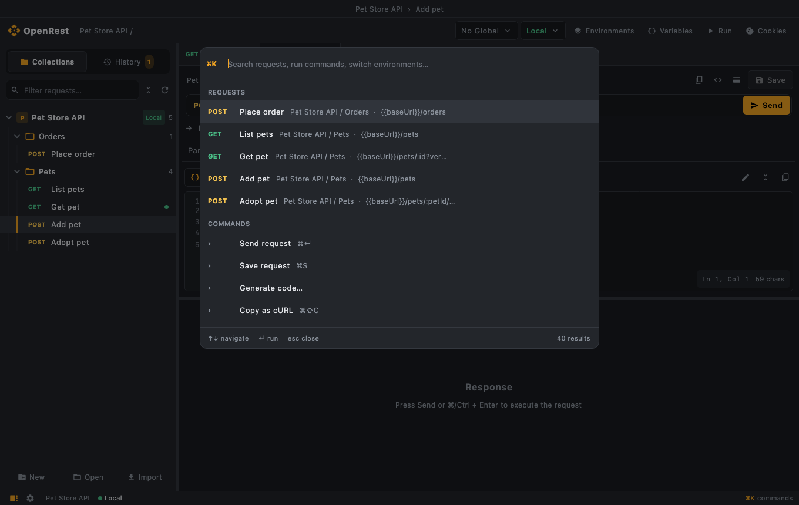
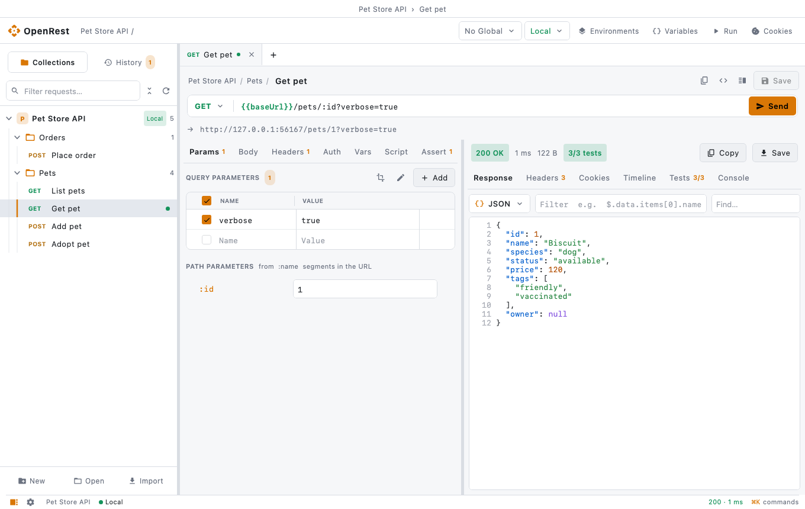

<h1 align="center">OpenRest</h1>

<p align="center">
  An open, file-based API client for the desktop. Requests, environments and workflows live in plain folders you own.<br>
  Built with Kotlin and Compose Multiplatform. Runs on macOS, Windows and Linux.
</p>

<p align="center">
  
</p>

## Why OpenRest

- **Your data stays yours.** Collections are folders of YAML files. They diff cleanly, review well in pull requests and live in git next to your code. Nothing is sent anywhere except the requests you run.
- **Workflows, not just requests.** Chain requests together with loops, conditions and values passed from one step to the next, built visually.
- **Bring your work with you.** Import from Postman, Insomnia, Bruno, OpenAPI and cURL, and export back out to the same formats.
- **Fast and keyboard friendly.** A command palette, variable autocomplete in every field and shortcuts for everything you do often.

## Features at a glance

| | |
|---|---|
| **Requests** | All HTTP methods, query and path parameters, headers, JSON / text / XML / GraphQL / form / multipart / file bodies, and Basic, Bearer, API key, Digest and OAuth 2 auth |
| **Collections** | Nested folders with shared headers, auth, variables and scripts that every request inside inherits |
| **Environments** | Global and per-collection environments, secret variables kept out of your files, `{{variable}}` highlighting and autocomplete |
| **Workflows** | A visual builder: request steps, if / else, loops, counters and sums, waits, stops, with `{name}` values passed between steps and a run log |
| **Scripting** | JavaScript before and after each request, no-code assertions, and `test()` / `expect()` tests |
| **Response viewer** | Pretty JSON and XML, search, JSONPath filter, headers, cookies, timeline, tests, console, image preview and a response history with diff |
| **Runner** | Run a whole collection or one folder, with iterations, delays and stop-on-failure |
| **Code generation** | cURL, JavaScript, Node.js, Python, Java, Kotlin, Go, PHP, C#, Ruby, Swift, Rust, Dart, PowerShell and more |
| **Import / export** | Postman, Insomnia, Bruno, OpenAPI / Swagger, cURL, `.http` files and OpenRest bundles |
| **Desktop polish** | System, light and dark themes, native menus, custom Windows and Linux title bar, first-run walkthrough, zoom, draggable tabs |

See [docs/features.md](docs/features.md) for the full tour with screenshots.

## Screenshots

| | |
|---|---|
|  |  |
| **Workflow builder** with its run log | **Collection runner** |
|  |  |
| **Command palette** (⌘K / Ctrl+K) | **Light theme**, side-by-side layout |

## Quick start

You need **JDK 17 or newer**.

```bash
git clone <this repository>
cd OpenRest
./gradlew :desktopApp:run
```

On first launch a short walkthrough helps you create, open or import a collection. To build an installer instead, run `./gradlew :desktopApp:packageDmg` (macOS), `packageMsi` (Windows) or `packageDeb` (Linux). More in [docs/getting-started.md](docs/getting-started.md) and [docs/building-and-releasing.md](docs/building-and-releasing.md).

## A collection is just a folder

```
my-api/
  openrest.yaml          # collection: name, auth, headers, variables, scripts
  environments/dev.yaml  # variables for an environment
  workflows/Checkout.yaml
  Ping.yaml              # a request
  Users/
    folder.yaml          # folder-level headers, auth, variables, scripts
    Get user.yaml
```

```yaml
name: Get user
method: GET
url: '{{baseUrl}}/users/:id?verbose=true'
headers:
- {name: Accept, value: application/json}
auth: {type: bearer, token: '{{token}}'}
assertions: [{name: res.status, value: eq 200}]
```

The full format is described in [docs/file-format.md](docs/file-format.md).

## Documentation

| Guide | What it covers |
|---|---|
| [Getting started](docs/getting-started.md) | Install, first run, your first request |
| [Features](docs/features.md) | Everything OpenRest can do, with screenshots |
| [Environments and variables](docs/environments-and-variables.md) | `{{variables}}`, scopes, secrets, dynamic values |
| [Workflows](docs/workflows.md) | The visual workflow builder in depth |
| [Scripting and testing](docs/scripting-and-testing.md) | Scripts, assertions, tests, the runner |
| [Import and export](docs/import-export.md) | Moving between OpenRest and other tools |
| [File format](docs/file-format.md) | The YAML on disk |
| [Keyboard shortcuts](docs/keyboard-shortcuts.md) | Every shortcut |
| [Project structure](docs/project-structure.md) | How the source code is organised |
| [Building and releasing](docs/building-and-releasing.md) | Run, test, package, regenerate screenshots |
| [Contributing](docs/contributing.md) | How to help, coding conventions, pull requests |
| [Troubleshooting](docs/troubleshooting.md) | Common problems and where your data lives |

## Contributing

Bug reports, ideas and pull requests are welcome. Start with [docs/contributing.md](docs/contributing.md) and [docs/project-structure.md](docs/project-structure.md).

## License

A license has not been chosen for this project yet.
