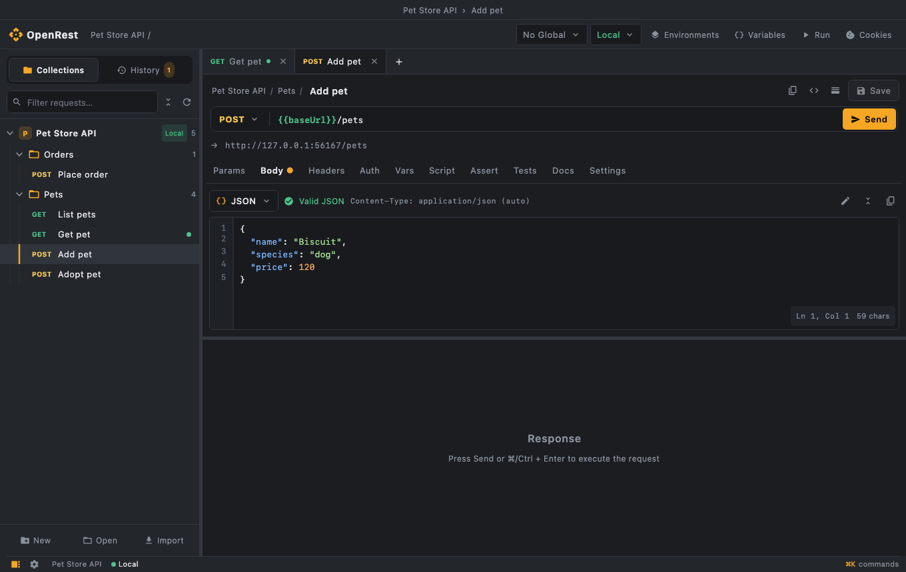
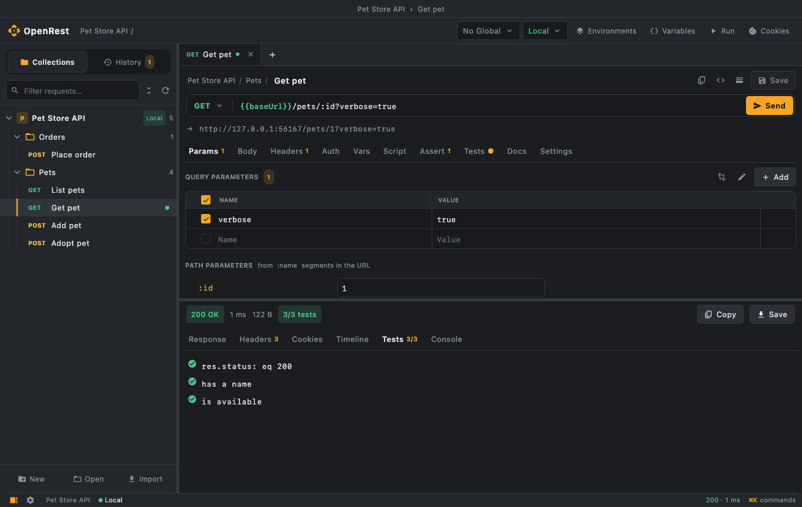
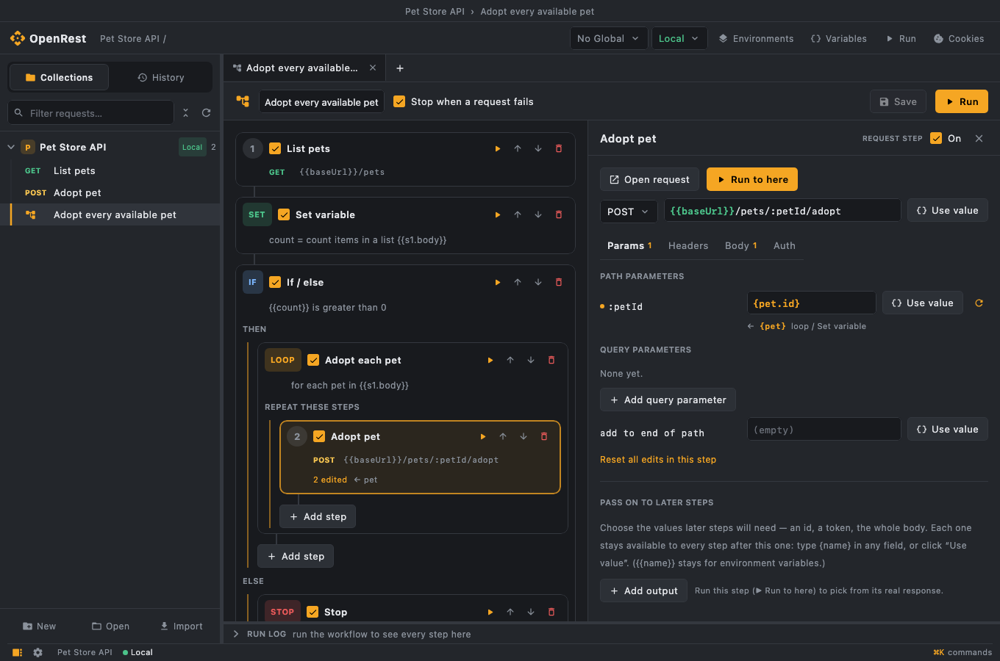
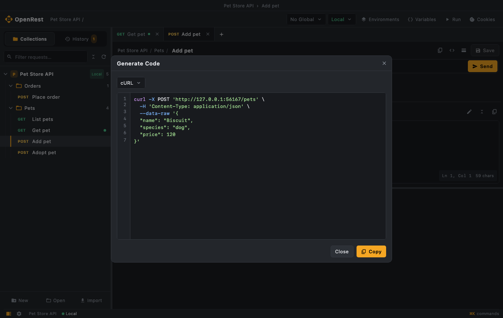
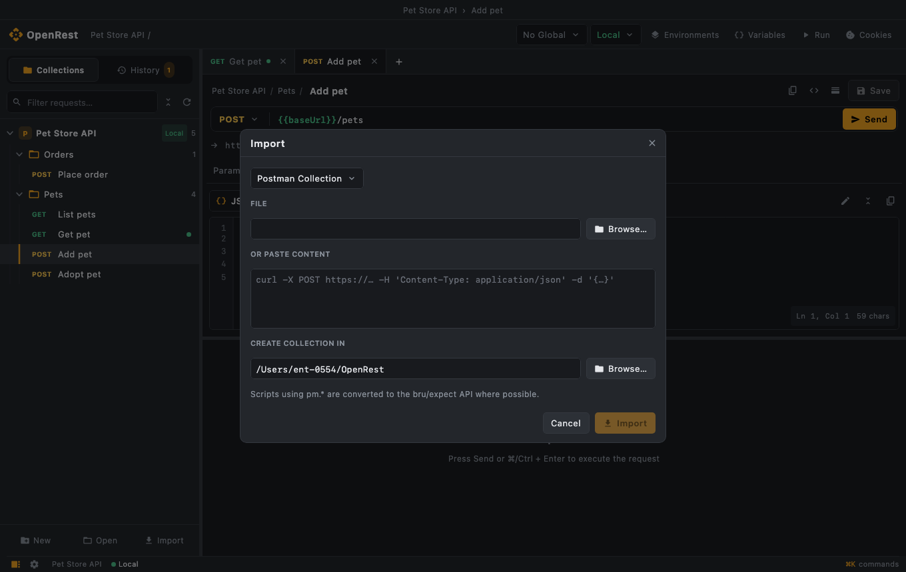
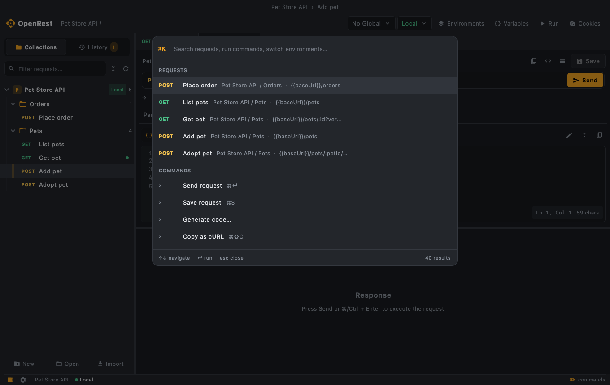
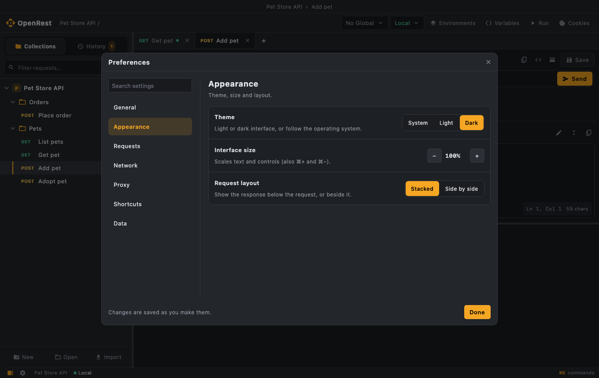
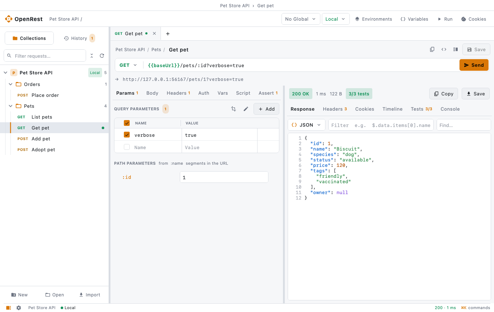

# Features

A tour of what OpenRest can do. Each section links to a deeper guide where there is one.

## Requests

- Every HTTP method, with **query parameters** and **path parameters** (`:id` in the URL) kept in sync with the URL.
- **Bodies:** JSON, text, XML, GraphQL (query and variables), form URL-encoded, multipart (text and files) and a raw file.
- **Auth:** none, inherit from the folder or collection, Basic, Bearer, API key (header or query), Digest and OAuth 2.
- Per-request **variables**, **scripts**, **assertions**, **tests**, **docs** (Markdown notes) and **settings** (timeout, redirects).
- Paste a `curl …` command into the URL bar and OpenRest fills in the method, headers and body.
- The resolved URL is previewed under the URL bar, with a warning for undefined variables.

## Responses

- Pretty-printed **JSON** and **XML**, plus HTML preview, raw text and image preview.
- **Filter** a JSON response with a JSONPath expression, and **search** inside it.
- **Headers**, **Cookies**, a **Timeline** (DNS, connect, TLS, wait, download), **Tests** and **Console** tabs.
- A **response history** per request, with a side-by-side **diff** against an older response.
- Copy or save any response.

## Collections and the sidebar

- Collections are **folders on disk**; requests are YAML files ([file format](file-format.md)).
- Nested folders carry shared headers, auth, variables and scripts that everything inside inherits.
- **Drag and drop** to move or reorder requests and folders. Rename inline with F2. Navigate with the arrow keys.
- A **History** tab lists every request sent this session, with its full response.
- A filter box finds requests quickly; collapse or expand every folder in one click.

## Environments and variables

- **Global** environments (available everywhere) and **collection** environments (travel with the collection).
- **Secret** variables are kept out of the YAML files.
- `{{variable}}` is highlighted green when defined and red when missing, and autocompletes in every field.
- Dynamic values such as `{{$guid}}` and `{{$timestamp}}`, and `{{process.env.NAME}}` with `.env` support.

Details: [Environments and variables](environments-and-variables.md).

## Workflows

Build multi-step API flows visually. Each request step can pass values on to later steps by name, and you can add **if / else**, **loops** (for each, repeat, while), **counters and sums**, **waits** and **stop** steps. A docked **run log** shows what happened, step by step.

Details: [Workflows](workflows.md).

## Scripting, assertions and tests

JavaScript before and after every request (`bru`, `req`, `res`, `console`), no-code assertions with 27 operators, and chai-style `test()` / `expect()`. See [Scripting and testing](scripting-and-testing.md).

## Collection runner

Run a whole collection or one folder with iterations, a delay between requests and stop-on-failure. Results list status, time and test outcomes per request.

## Code generation

Turn any request into code: cURL, JavaScript (fetch, axios), Node.js, Python, Java, Kotlin, Go, PHP, C#, Ruby, Swift, Rust, Dart, PowerShell, HTTPie and wget. Copy it or save it to a file. ⌘⇧C copies the request as cURL straight away.

## Import and export

Postman, Insomnia, Bruno, OpenAPI / Swagger, cURL and OpenRest bundles in; Postman, Bruno, OpenAPI, Insomnia, `.http`, cURL scripts and bundles out. See [Import and export](import-export.md).

## Command palette

⌘K / Ctrl+K searches every request in every open collection and runs any command: send, save, switch environment, change theme, open a workflow, toggle layout and more.

## Preferences, themes and layout

- **Theme:** System (default), Light or Dark, switched instantly.
- **Layout:** request above the response, or side by side. Drag the divider to resize.
- Text size and zoom, default timeout, redirects, SSL verification, proxy, user agent and auto-save.

## Desktop integration

- **macOS:** native menu bar and traffic-light buttons, with About, Preferences and Quit in the application menu.
- **Windows and Linux:** a custom title bar with the menus built in, window buttons and resizable edges; maximising respects the taskbar.
- Open tabs, sidebar width and layout are restored when you relaunch.
- A first-run [walkthrough](getting-started.md#first-run), replayable from **Help ▸ Welcome Tour**.
