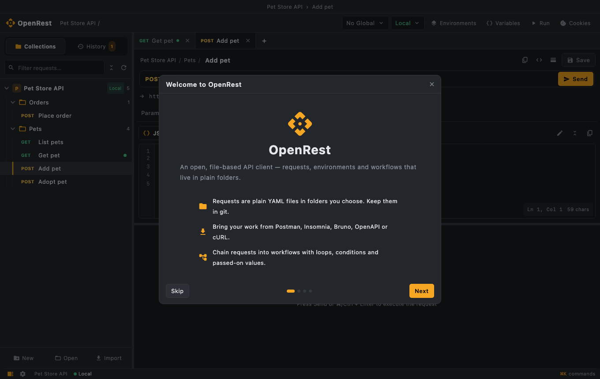

# Getting started

## Install

OpenRest is distributed as a normal desktop installer:

| System | File | How |
|---|---|---|
| macOS | `OpenRest-<version>.dmg` | Open the DMG and drag **OpenRest** to Applications |
| Windows | `OpenRest-<version>.msi` | Run the installer |
| Linux | `.deb` package | `sudo apt install ./<file>.deb` |

The installers are not code-signed yet. On macOS, if Gatekeeper blocks the first launch, right-click the app and choose **Open**.

To run from source instead you need JDK 17 or newer:

```bash
./gradlew :desktopApp:run
```

See [building and releasing](building-and-releasing.md) to produce the installers yourself.

## First run

On a fresh install OpenRest opens a short walkthrough. You can skip it at any time and bring it back with **Help ▸ Welcome Tour**.



1. **Welcome**: what OpenRest is.
2. **Make it yours**: theme (System by default), layout and text size.
3. **Quick tour**: the shortcuts worth learning first.
4. **Get started**: create a collection, open an existing folder, or import.

## Your first request

1. **Create a collection.** Click **New Collection** in the sidebar, choose a name and a folder. The folder is created for you and holds one YAML file per request.
2. **Add a request.** Click **+** on the collection, or press ⌘N / Ctrl+N. Give it a name.
3. **Fill it in.** Pick a method, type a URL, and add headers, a body or auth in the tabs below.
4. **Send it.** Press **Send** or ⌘↵ / Ctrl+Enter. The response appears below (or beside, in side-by-side layout).
5. **Save it.** Press ⌘S / Ctrl+S. Unsaved tabs show a dot.


## Next steps

- Keep base URLs and tokens in an [environment](environments-and-variables.md) so one collection works against local, staging and production.
- Add [assertions and tests](scripting-and-testing.md) so you know when something breaks.
- Chain calls together with a [workflow](workflows.md).
- Already using Postman, Insomnia or Bruno? [Import](import-export.md) your collections.
- Press ⌘K / Ctrl+K at any time to search requests and run any command.

Everything OpenRest stores about you (settings, open collections, global environments and secret values) lives in `~/.openrest`; see [troubleshooting](troubleshooting.md).
