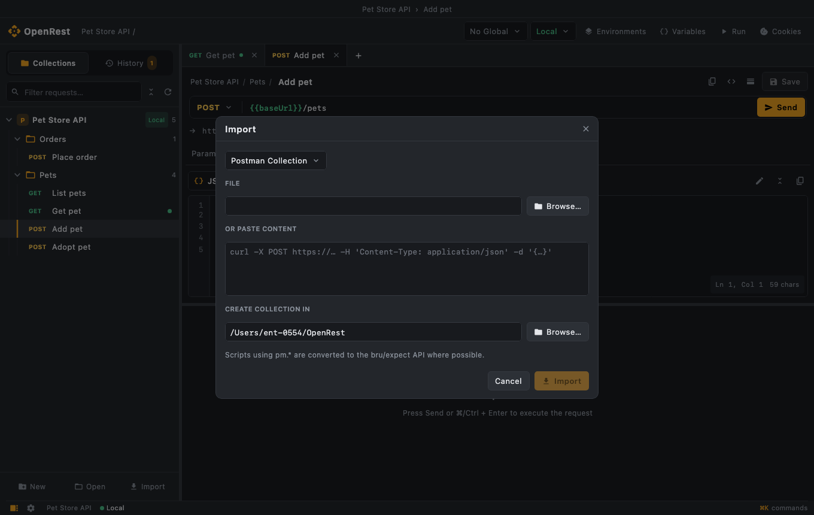

# Import and export

## Import

**File ▸ Import** (or **Import** in the sidebar, or the command palette):

| Source | Notes |
|---|---|
| Postman collection | v2 / v2.1 JSON |
| Postman environment | Into the current collection, or as a global environment |
| Insomnia | v4 export |
| OpenAPI / Swagger | JSON or YAML. Requests are grouped by tag; the server URL becomes `{{baseUrl}}` in a **Default** environment |
| Bruno collection | Pick the folder (`bruno.json` + `.bru` files); it is converted into an OpenRest collection |
| cURL | Paste one command, or paste a `curl …` into any URL bar |
| OpenRest bundle / collection | A single-file bundle or a collection folder |

Imports never modify the source; they create a new collection folder where you choose.

## Export

Use **Export…** on a collection (its menu, or the command palette):

| Target | Result |
|---|---|
| Postman v2.1 | A `.json` collection |
| Bruno | A folder of `.bru` files |
| OpenAPI 3 / Swagger | YAML or JSON |
| Insomnia v4 | A `.json` file |
| `.http` file | For VS Code REST Client and JetBrains HTTP Client |
| cURL script | A shell script with one command per request |
| OpenRest bundle | The whole collection in a single YAML file |

## Sharing a collection

Because a collection is a plain folder, the simplest way to share it is git. Secret variable values are stored outside the collection (in `~/.openrest/secrets.json`), so they are not committed.
