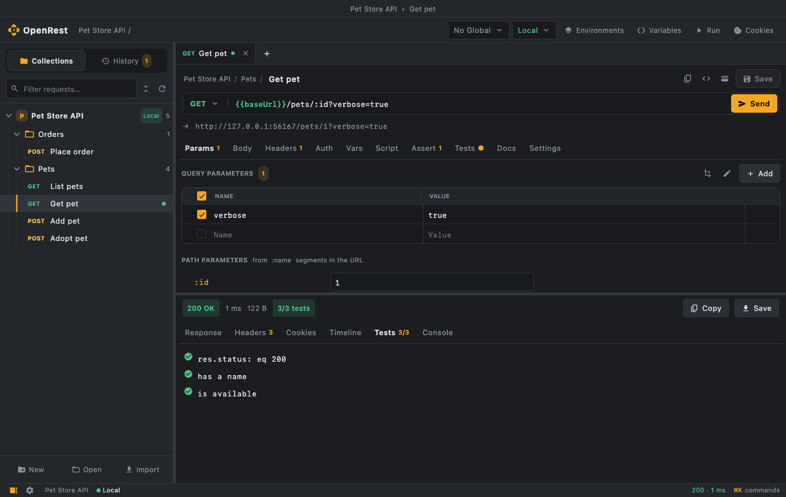
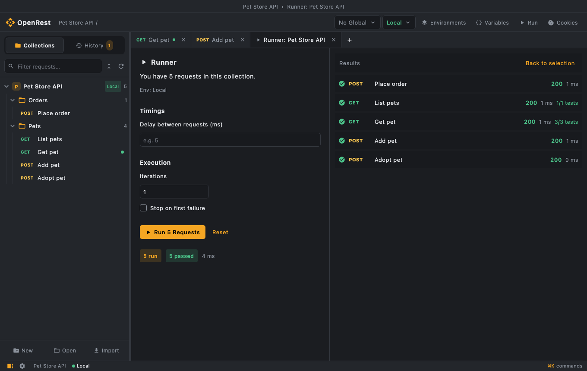

# Scripting and testing

OpenRest runs JavaScript (GraalJS, with `async`/`await`) before and after requests, and offers no-code assertions and chai-style tests. The scripting API follows Bruno's, so most Bruno scripts work unchanged.

## Where scripts run

Each request has a **Script** tab with **Pre Request** and **Post Response** editors. Collections and folders have their own scripts too. Order: collection, then folders, then the request before sending; and the request, then folders, then the collection after the response.

## Before the request

```js
req.setHeader('X-Time', Date.now());
req.setUrl(bru.interpolate('{{baseUrl}}/v2/users'));
req.setBody(JSON.stringify({ name: 'Ada' }));
bru.setVar('startedAt', Date.now());
```

## After the response

```js
bru.setVar('token', res.body.access_token);       // for later requests this session
bru.setEnvVar('token', res.body.access_token);    // update the active environment
console.log('status', res.status);
```

`console.log`, `info`, `warn` and `error` appear in the response's **Console** tab.

## The API

| Object | Members |
|---|---|
| `bru` | `getVar`, `setVar`, `hasVar`, `deleteVar`, `deleteAllVars`, `getEnvVar`, `setEnvVar`, `getEnvName`, `getCollectionName`, `getCollectionVar`, `getFolderVar`, `getRequestVar`, `getProcessEnv`, `interpolate`, `sleep`, `cwd`, `setNextRequest`, `skipRequest`, `stopExecution` |
| `req` | `getUrl`, `setUrl`, `getMethod`, `setMethod`, `getName`, `getHeader`, `getHeaders`, `setHeader`, `setHeaders`, `deleteHeader`, `getBody`, `setBody`, `getTimeout`, `setTimeout`, `setMaxRedirects`, `getAuthMode` |
| `res` | `status`, `statusText`, `headers`, `body`, `responseTime` and helpers |
| `console` | `log`, `info`, `warn`, `error`, `debug` |

`bru.setNextRequest('Name')`, `skipRequest()` and `stopExecution()` steer the [collection runner](#the-collection-runner).

## Assertions (no code)

The **Assert** tab takes an expression and a check, for example `res.status` `eq 200` or `res.body.items` `isArray`.

Operators: `eq`, `neq`, `gt`, `gte`, `lt`, `lte`, `in`, `notIn`, `contains`, `notContains`, `length`, `matches`, `notMatches`, `startsWith`, `endsWith`, `between`, `isEmpty`, `isNotEmpty`, `isNull`, `isUndefined`, `isDefined`, `isTruthy`, `isFalsy`, `isJson`, `isNumber`, `isString`, `isBoolean`, `isArray`.

## Tests

```js
test('returns the pet', () => {
  expect(res.status).to.equal(200);
  expect(res.body.name).to.equal('Biscuit');
});
```

Results appear in the **Tests** tab of the response and as a `3/3 tests` badge next to the status.



## Post-response variables

On the **Vars** tab, a **Post Response** variable such as `id` = `res.body.id` stores a value after each run without writing a script. Use it in the next request as `{{id}}`.

## The collection runner

Run every request in a collection (or one folder) in order: press **Run** in the header, or use the folder's menu. Choose which requests to include, set a **delay** between requests, the number of **iterations**, and whether to **stop on the first failure**.



Each result shows status, time and test counts. Click one to see the full request and response.
