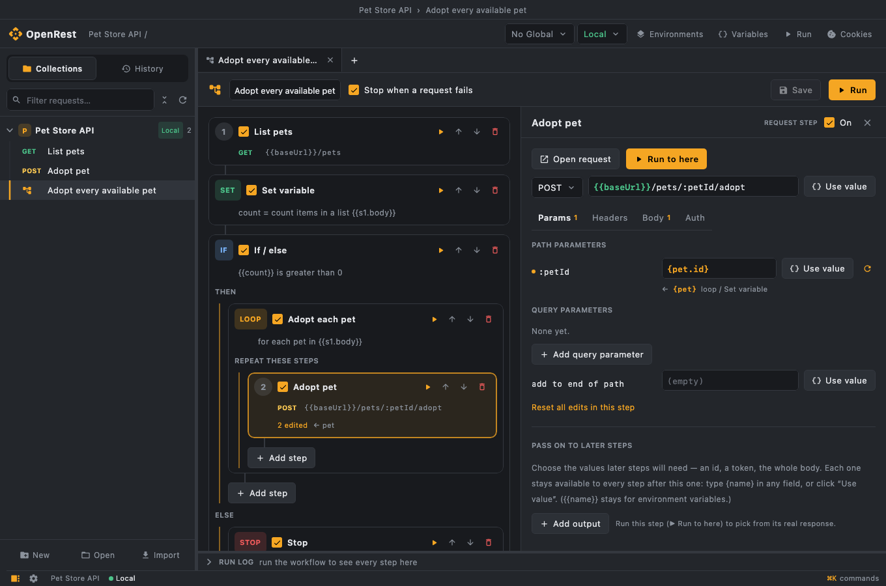

# Workflows

A **workflow** chains requests together with logic, so the output of one call feeds the next. Typical uses: log in then call a protected endpoint, list items then update each one, poll until something is ready, or run a whole business scenario as one repeatable flow.

Create one from the collection's menu (**New Workflow**), from **Workflow ▸ New Workflow**, or with the command palette. Workflows are saved next to your requests in the collection's `workflows/` folder.



## The builder

- **Left:** the outline of steps, in the order they run. Each block can be enabled or disabled, moved up or down, deleted, or run on its own up to that point (**Run to here**).
- **Right:** the configuration of the selected block. Click a block to open it and the **×** to close it.
- **Bottom:** the run log, docked below. Drag its top edge to resize it, or fold it to just its bar.

## Block types

| Block | What it does |
|---|---|
| **Request** | Runs a request from the collection. You can change its method, URL, parameters, headers, body and auth for this step only |
| **If / else** | Runs the **then** steps when all conditions hold, otherwise the **else** steps. Conditions compare two values: equals, contains, is greater than, is empty, matches a pattern and more |
| **Loop** | Repeats its steps **for each item** in a list, **a number of times**, or **while** a condition is true |
| **Set variable** | Stores a value, or **counts** the items in a list, **adds up** numbers, or takes the **first** or **last** item |
| **Wait** | Pauses for a number of milliseconds |
| **Stop** | Ends the current loop or the whole workflow, optionally marking the run as failed with a message |

## Passing values between steps

Open a request step and use **Pass on** to give a name to something from its response:

- the whole body, or one field of it by path, such as `data.items[0].id`
- the status code, a header, the response time, or the entire response

From then on, every later step can use it as `{name}`. Open **Inputs** on a later request and aim a value at a **path parameter**, **query parameter**, **header**, the **full body** or **one field inside the body**.

Rules of thumb:

- `{name}` is a value from the workflow. `{{name}}` is an environment or collection variable. They never clash.
- Plain JSON braces in a body are left alone; only names the workflow knows are replaced.
- Inside a loop you also get the loop's item (for example `{pet.name}` if you called it `pet`) and `{index}`.

Select a request step and pick **Info** to see exactly which values it takes from earlier steps.

## Running and reading the log

Press **Run** (or **Workflow ▸ Run**). **Stop** cancels. The log lists each step as it runs, all collapsed by default:


- Expand a row to see the values it passed on, in a table with a **Copy** button per value.
- **View response** on a request row opens the full response of that step, including each round of a loop.
- The summary shows how many steps ran, how long the requests took, and whether everything was ok.

## Example

This workflow lists pets, counts them, and if there are any, adopts each one by calling a request with the pet's id and name; otherwise it stops with a message.

```yaml
name: Adopt every available pet
steps:
- id: s1
  request: List pets.yaml
- id: s2
  kind: set
  op: count
  name: count
  list: '{{s1.body}}'
- id: s3
  kind: if
  conditions:
  - {left: '{{count}}', op: gt, right: '0'}
  then:
  - id: s4
    kind: loop
    title: Adopt each pet
    mode: each
    list: '{{s1.body}}'
    item: pet
    do:
    - id: s5
      request: Adopt pet.yaml
      inputs:
      - {target: path, name: petId, value: '{pet.id}'}
      - {target: body, name: adopter, value: '{pet.name}'}
  else:
  - id: s6
    kind: stop
    scope: workflow
    fail: true
    message: There are no pets to adopt
```

You normally never edit this by hand, but it is plain YAML like everything else, so it reviews and merges well in git.
